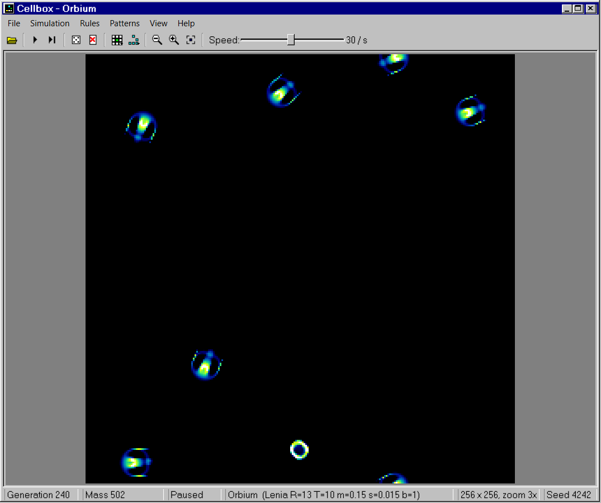
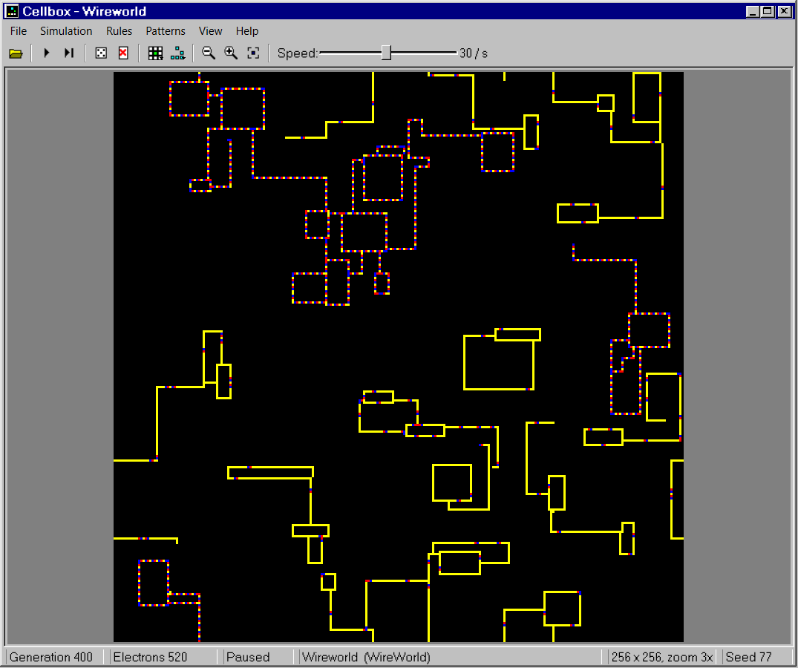
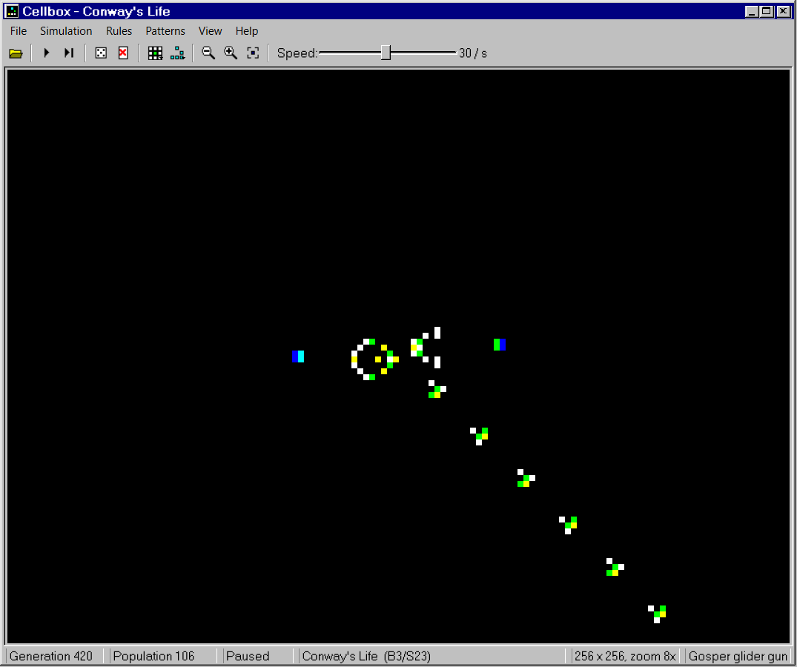

# Cellbox

Cellular automata in a Windows 95 box. Pick a rule, seed the field, and watch it live: classic Life,
electrons running through Wireworld circuits, or the soft, swimming creatures of Lenia.



## Three kinds of worlds

- **Life-like and Generations rules** in B/S notation (`B3/S23` is Conway's Life, `B2/S/C3` is Brian's
  Brain). Twelve presets, or type your own under Rules → Custom. Live cells change color with age
  (newborn white, then yellow, lime, cyan and blue for the long-lived); Generations cells fade from dark
  red to navy.
- **Wireworld**: electrons (blue heads, red tails) run along yellow wires. A reseed builds a random
  circuit board of clock loops and wandering wires that keeps flickering; the pattern library has working
  clocks, diodes and OR and XOR gates.
- **Lenia**, Bert Chan's continuous automaton: every cell holds a value from 0 to 1 and grows or shrinks
  according to a smooth ring of neighbors. Pick a species from Rules → Lenia (Orbium, Scutium,
  Gyropteron, Helicium, Kronium, Hydrogeminium) and a reseed scatters that creature around the field.
  Steps are an FFT convolution, about a thousand a second on a 256 x 256 field.



## Patterns

The Patterns menu holds a library: spaceships, oscillators, glider guns and methuselahs for Life, the
HighLife replicator, Wireworld circuits, and 25 Lenia creatures. Choosing one starts a fresh field with it
in the middle; after that every click places another copy where the see-through outline is (right-click
or T turns it, Esc stops).

Patterns are RLE, the format of Golly and LifeWiki, including multi-state rules:

- File → Open Pattern (Ctrl+O), or drop an `.rle` file on the window or on `Cellbox.exe`;
- copy an RLE from LifeWiki and paste it (Ctrl+V);
- File → Save Pattern As (Ctrl+S) or Copy Pattern (Ctrl+C) writes what is on the field.



Every pattern in the library is checked by the tests: spaceships return to their shape after their
period, the R-pentomino settles at 116 cells on generation 1103, the Gosper gun adds a glider every 30
generations, the replicator copies itself, the circuits give exactly the outputs of an ideal gate, and
the Lenia creatures keep their mass. The Wireworld diode and gates are shapes found by brute-force search
(`tools/make_circuits.py` builds and verifies them).

## The box

- **Field**: 128², 256², 512² or 1024² cells on a torus: the edges wrap around.
- **Seeding**: density, the whole field or a spot in the center, and a seed number to replay a run.
- **Speed**: 1 to 60 steps per second, or Max. A numba-compiled kernel steps a 1024² Life field about
  200 times a second.

Settings (rule, size, seeding, speed, window) are kept in `%APPDATA%\KosmoStars\Cellbox.ini`; the
compiled engine is cached in `%LOCALAPPDATA%\KosmoStars\Cellbox\numba`, so only the first launch compiles it.

## Keys

| Key | Action |
| --- | --- |
| Space | Run or pause |
| N | One step |
| R | Reseed |
| C | Clear |
| + / - | Zoom in / out (or the mouse wheel) |
| F | Fit the field to the window (or double-click) |
| Drag | Pan |
| Ctrl+O / Ctrl+S | Open / save an RLE pattern |
| Ctrl+C / Ctrl+V | Copy the field / paste a pattern |
| Click, right-click, Esc | While placing: place a copy, turn it, stop |

## Run

```
pip install -r requirements.txt
python main.py
```

Tests: `pip install -r requirements-dev.txt`, then `python -m pytest`.

Build a single portable `Cellbox.exe`: `python tools/build.py`. Sounds are synthesized by
`tools/make_sounds.py`; any WAV in `assets/sounds` can be swapped for your own.

## Credits

Lenia and its creatures are by Bert Chan: the species in `assets/patterns/lenia.json` come from his
catalogue at https://github.com/Chakazul/Lenia (MIT license, © 2018 Bert Chan), picked by
`tools/make_lenia_species.py`. The Life patterns are classics found by John Conway, Richard Guy, Bill
Gosper, Charles Corderman, Michael Simkin and others; the comments in each RLE file name them.

## License

MIT, see [LICENSE](LICENSE).
